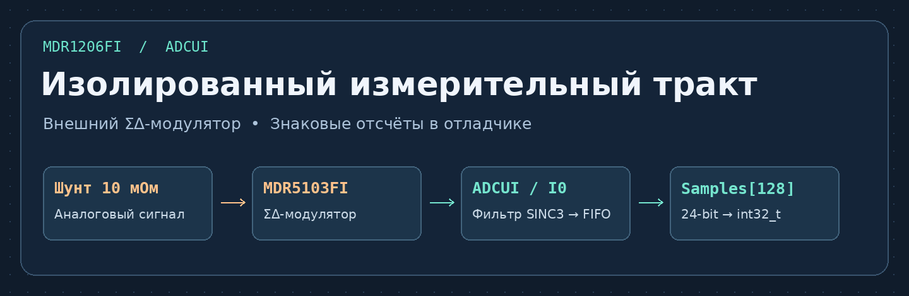

# MDR1206FI · внешний сигма-дельта АЦП

Демонстрационный проект для **MDR1206FI** и изолированного модулятора **MDR5103FI**. Микроконтроллер тактирует внешний модулятор, принимает однобитный поток и преобразует его в знаковые 24-разрядные отсчёты с помощью **ADCUI**. Для просмотра в отладчике прошивка циклически заполняет массив из 128 отсчётов.

[Исходник](src/main.c) · [Подключение](#подключение) · [Сборка и запуск](#сборка-и-запуск) · [Статья Миландр][article]

| Параметр | Значение в примере |
| --- | --- |
| Входная опорная частота HSE | 8 МГц |
| Частота тактирования модулятора | 1 МГц |
| Передискретизация ADCUI | OSR 256 |
| Частота отсчётов | 3 906,25 Гц |
| Окно в отладчике | 128 отсчётов, около 32,8 мс |

## Подключение

На цифровой стороне соедините разъём **XP1** модуля с отладочной платой MDR1206FI.

| Контакт XP1 | Сигнал | Куда подключить |
| --- | --- | --- |
| 1 | DOUT | PD10, `SD_I0_EXT`. Данные от модуля к микроконтроллеру |
| 2 | GND | GND цифровой стороны |
| 3 | CLK | PD14, `CLK_SD_EXT`. Тактирование от микроконтроллера к модулю |
| 4 | VDD | +3,3 В |

Клеммы X1 и X2 находятся на изолированной измерительной стороне модуля. Для проверки используйте лабораторный генератор и схему из статьи. [Схема подключения и условия измерения][article].

## Сборка и запуск

Понадобятся **Eclipse CDT** с поддержкой GNU MCU RISC-V, **xPack GNU RISC-V Embedded GCC** с префиксом `riscv-none-elf-` и **OpenOCD** от Миландр с конфигурацией `target/MDR1206FI.cfg` для отладки.

1. Скачайте ZIP по ссылке [«Пример работы MDR1206FI с MDR5103FI»][archive] со страницы статьи. Из корня репозитория импортируйте файлы поддержки. Скрипт копирует `Library/`, `bootloader/` и `svd/`, сохраняя исходник проекта.

   ```console
   python tools/import_sdk.py "путь/к/архиву.zip"
   ```

2. В Eclipse выберите **File → Import → General → Existing Projects into Workspace**, затем каталог репозитория. Имя проекта в рабочей области — `MDR1206FI_MDR5103FI`.
3. Выберите конфигурацию сборки. В [launch_cfg/](launch_cfg/) есть профили для соответствующих отладчиков. Путь к OpenOCD задаётся в Eclipse.

   | Конфигурация | Профиль OpenOCD |
   | --- | --- |
   | `MDR1206_RAM_TCM_Debug` | FTDI FT2232HL, отладочная сборка в ОЗУ |
   | `MDR1206_RAM_TCM_Release` | FTDI FT2232HL, оптимизированная сборка в ОЗУ |
   | `MDR1206_FLASH` | CMSIS-DAP, запуск из Flash с загрузчиком из архива |

4. Запустите прошивку, дайте заполниться массиву и посмотрите `Samples` в отладчике. Значения — знаковые коды АЦП. При частоте входного сигнала 50 Гц в одном периоде ожидается около 78 отсчётов.

В статье приведён стендовый результат около **±260 000 кодов** для описанной там схемы и настроек генератора. Это ориентир для воспроизведения эксперимента. Амплитуда кодов зависит от сигнала на шунте и параметров стенда. [Условия и график измерения][article].

Компиляция и линковка проверены с xPack GCC 14.2.0 и всеми тремя линкерными скриптами из архива. Запуск с отладчиком и измерения на плате не проверялись при подготовке этого репозитория.

## Что делает прошивка

1. Настраивает тактирование ADCUI и выводы внешнего модулятора на порту D.
2. Включает токовый канал `F0/I0` и считывает результаты из FIFO после цифровой фильтрации.
3. Пропускает первые 64 отсчёта после запуска фильтра и расширяет каждый 24-разрядный результат до `int32_t` со знаком.
4. Записывает последовательные отсчёты в `Samples[128]` для просмотра в отладчике.

## Источники

Автор статьи — **Илья Лампадов**. Проект использует файлы поддержки и загрузчик из официального архива АО «ПКК Миландр». Они импортируются локально по шагу сборки. [Оригинальная статья и файлы][article] · [Условия портала][terms].

[article]: https://support.milandr.ru/base/primenenie/programmirovanie-32-razryadnykh-mk/rabota_s_atsp/69443/
[archive]: https://support.milandr.ru/upload/iblock/d52/fyipzgp09ug1nhirum5k649zynvzlcqr/%D0%9F%D1%80%D0%B8%D0%BC%D0%B5%D1%80%20%D1%80%D0%B0%D0%B1%D0%BE%D1%82%D1%8B%20MDR1206FI%20%D1%81%20MDR5103FI.zip
[terms]: https://support.milandr.ru/terms/
